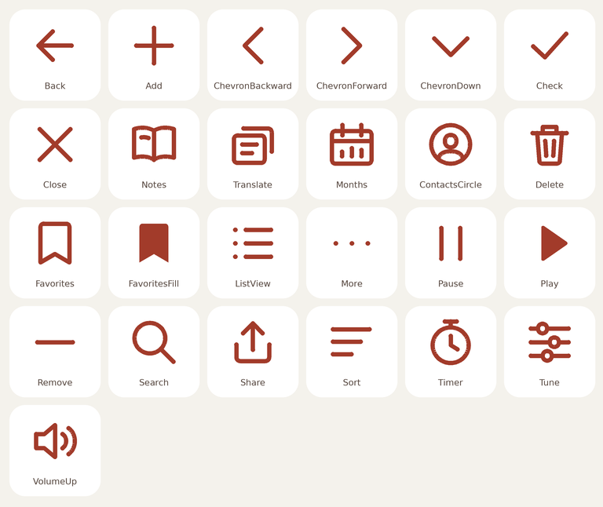

# 灵阅图标系统

启动图标以「月牙升起于开卷」为标志：暖纸色书页与月光落在朱砂色底上。自适应图标提供圆形、圆角方形裁切，Android 主题图标使用同一标志的独立单色轮廓。

界面图标均为项目内绘制的矢量图形，共 25 种。它们使用 24 dp 画布、1.85 dp 圆端笔画与一致的留白；书架、生词本和阅读统计分别以开卷、字卡、日期刻度表达。图标颜色由界面主题实时着色，适配动态配色及阅读页的明暗主题。

界面图标源文件为 `app/src/main/java/com/xycs/lingyuereader/ui/LingYueIcons.kt`。启动图标位于 `app/src/main/res/drawable/ic_launcher_*.xml`；听书与阅读提醒使用独立的透明单色 `ic_notification.xml`，确保通知栏在各系统主题下清晰显示。
